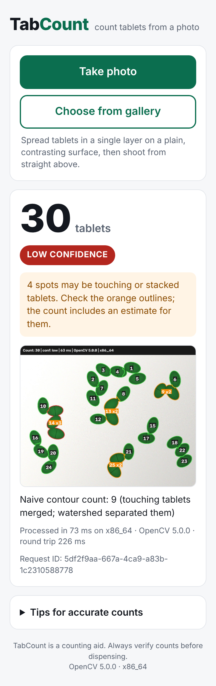
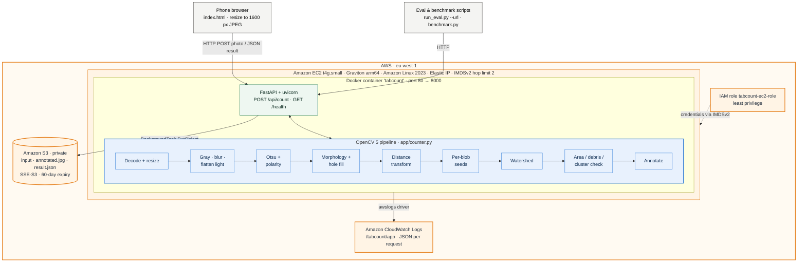

# TabCount

**Count loose tablets from one phone photo.** Spread tablets in a single layer on a contrasting tray,
take a photo, and TabCount returns the count, a confidence level, and an annotated image with every
tablet outlined and numbered. It is built for community pharmacies and patent medicine stores in
Nigeria, where tablets are still counted by hand at dispensing and stock-taking.

All image processing is classic computer vision with **OpenCV 5** (no deep learning). It runs in a
Docker container on an **AWS Graviton (arm64) EC2** instance, with private S3 storage and CloudWatch logging.

**Headline (real phone photos, test split, n=<!--V:REAL_N_TEST-->{{REAL_N_TEST}}<!--/V-->):** exact count on <!--V:REAL_EXACT-->{{REAL_EXACT}}<!--/V--> of photos, within ±1 on <!--V:REAL_WITHIN1-->{{REAL_WITHIN1}}<!--/V-->, against <!--V:REAL_BASE_EXACT-->{{REAL_BASE_EXACT}}<!--/V--> exact for a naive contour count on the same preprocessing.

**Live demo:** <!--V:LIVE_URL-->{{LIVE_URL}}<!--/V-->  ·  **Report:** [docs/REPORT.md](docs/REPORT.md)  ·  **Entry:** OpenCV AI Competition 2026 (powered by AWS)


<p align="center"></p>

## How it works

1. **Preprocess:** decode, resize (longest side ≤ 1200 px), grayscale, blur, flatten uneven lighting,
   **Otsu threshold**, detect polarity from the image border (light-on-dark or dark-on-light),
   morphological close/open, fill holes.
2. **Split touching tablets:** distance transform → **per-blob seeds** (each blob's peaks are thresholded
   relative to that blob's own maximum) → marker-based **watershed**.
3. **Check areas:** drop crumbs below 25% of the median tablet area; flag objects above 1.8× the median
   as possible clusters and count them as `round(area / median)`.
4. **Report:** count, confidence (`high` / `medium` / `low`), plain-language warnings and an annotated JPEG.
   A naive contour count on the same preprocessing is returned too (`baseline_count`), so you can see
   what the watershed adds.

## Architecture



Detailed diagram: [docs/architecture.svg](docs/architecture.svg) (blue = OpenCV 5, orange = AWS).

## Results

Every number below is generated by `scripts/fill_report.py` from files in `eval/results/`.
Real-photo and synthetic results are reported separately; synthetic images are generated and are much easier than real photos.

<!-- RESULTS:START -->
<!-- generated by scripts/fill_report.py; do not edit by hand -->

**Real phone photos:** {{REAL_RESULTS_PENDING}}

#### Synthetic images (generated, NOT real photos)


Images: 200 labelled (67 tune / 133 test). 

Protocol: peak_ratio swept over [0.3, 0.4, 0.5, 0.6, 0.7] on the tune split only; best by MAE; headline metrics on the test split only. Default params = deployed system.

**Test split (synthetic)**

| Method | n | Exact | Within ±1 | MAE | MAPE % | Bias |
|---|---:|---:|---:|---:|---:|---:|
| watershed | 133 | 98% | 99% | 0.04 | 0.09 | -0.04 |
| watershed no cluster | 133 | 79% | 82% | 1.20 | 3.06 | -1.20 |
| baseline | 133 | 29% | 30% | 12.21 | 34.88 | -12.21 |
| watershed tuned | 133 | 100% | 100% | 0.00 | 0.0 | +0.00 |

**By condition (test)** (method: watershed vs baseline)

| Group | n | Exact (ws) | MAE (ws) | MAE (baseline) |
|---|---:|---:|---:|---:|
| mixed | 44 | 98% | 0.02 | 11.43 |
| separated | 39 | 100% | 0.00 | 0.00 |
| touching | 50 | 96% | 0.10 | 22.42 |

**By background (test)** (method: watershed vs baseline)

| Group | n | Exact (ws) | MAE (ws) | MAE (baseline) |
|---|---:|---:|---:|---:|
| dark | 56 | 100% | 0.00 | 13.16 |
| light | 77 | 96% | 0.08 | 11.52 |

**peak_ratio sweep (tune split, watershed with cluster correction)**

| peak_ratio | MAE | Exact |
|---:|---:|---:|
| 0.3 | 4.76 | 67% |
| 0.4 | 0.70 | 91% |
| 0.5 (default) | 0.01 | 99% |
| 0.6 (best) | 0.00 | 100% |
| 0.7 | 0.00 | 100% |

**Latency** (server-side pipeline, x86_64, OpenCV 5.0.0): p50 78.0 ms, p95 99.7 ms.

**Confidence vs accuracy (test, watershed)**

| Confidence | n | Exact | MAE |
|---|---:|---:|---:|
| high | 105 | 100% | 0.00 |
| medium | 14 | 100% | 0.00 |
| low | 14 | 79% | 0.43 |


**Live endpoint benchmark:** {{BENCHMARK_PENDING}}

<!-- RESULTS:END -->

## Quickstart (local)

Requires Python 3.12, 3.13 or 3.14 (not 3.11: the pinned numpy 2.5.4 needs 3.12+). Commands are given for **Windows PowerShell** and **macOS/Linux**.

```powershell
# Windows PowerShell
git clone https://github.com/emediong-etuk/tabcount.git
cd tabcount
py -3.12 -m venv .venv
.venv\Scripts\Activate.ps1
pip install -r requirements-dev.txt
uvicorn app.main:app --host 0.0.0.0 --port 8000 --workers 2 --no-access-log
```

```bash
# macOS / Linux
git clone https://github.com/emediong-etuk/tabcount.git && cd tabcount
python3.12 -m venv .venv && source .venv/bin/activate
pip install -r requirements-dev.txt
uvicorn app.main:app --host 0.0.0.0 --port 8000 --workers 2 --no-access-log
```

Open <http://localhost:8000>. From a phone on the same Wi-Fi, open `http://<your-computer-IP>:8000`
(`ipconfig` on Windows, `ifconfig`/`ip addr` elsewhere).

API example:

```bash
curl -F "file=@photo.jpg" "http://localhost:8000/api/count?debug=false"
```

Optional query parameters: `peak_ratio` (0.1–0.95), `cluster_correction` (true/false), `min_area_px` (1–100000), `debug` (true adds intermediate images and per-object data).

## Commands

Every `make` target has a plain Python equivalent (run from the repo root, with the venv active).
Scripts put the repo root on `sys.path` themselves, and tests get it from `pytest.ini`.

| Task | Plain command (all OSes) | make |
|------|--------------------------|------|
| Run tests | `python -m pytest` | `make test` |
| Synthetic data (n=200, seed 42) | `python scripts/make_synthetic.py --n 200 --seed 42 --out eval/data/synthetic` | `make synthetic` |
| Synthetic evaluation | `python scripts/run_eval.py --data eval/data/synthetic` | `make eval-synthetic` |
| Prepare real photos | `python scripts/prepare_real.py --src PATH\TO\PHOTOS` | n/a |
| Real-photo evaluation | `python scripts/run_eval.py --data eval/data/real` | `make eval-real` |
| Deployed consistency check | `python scripts/run_eval.py --data eval/data/real --url http://ELASTIC_IP` | n/a |
| Benchmark live endpoint | `python scripts/benchmark.py --url http://ELASTIC_IP --images eval/data/real --n 100 --concurrency 4` | `make benchmark URL=...` |
| Pipeline-stages figure | `python scripts/pipeline_figure.py eval/data/real/img_001.jpg` | `make figure` |
| Fill docs with results | `python scripts/fill_report.py` | `make fill-report` |
| Architecture SVG | `python scripts/architecture_svg.py` | n/a |

Evaluation protocol: `peak_ratio` is swept over 0.3–0.7 on the **tune** split only (about a third of the
images, chosen deterministically). Headline metrics are on the **test** split only and use the default
parameters, which are the ones deployed. See [eval/PHOTO_PROTOCOL.md](eval/PHOTO_PROTOCOL.md) for how the real photos were taken and labelled.

## Docker

```bash
docker build -t tabcount:latest .
docker run --rm -p 8000:8000 tabcount:latest
```

The image is `python:3.12-slim` (from the AWS ECR Public mirror) plus the pinned requirements. It runs as a
non-root user, has a `HEALTHCHECK`, and builds natively on arm64 and amd64.

## AWS deployment

Region `eu-west-1`. Full steps (script and console click-path): [docs/AWS_SETUP.md](docs/AWS_SETUP.md).

```powershell
aws sts get-caller-identity                                   # credentials via the default boto3 chain
python deploy/provision.py --region eu-west-1                 # prints the plan, asks for "yes"
python deploy/deploy.py --host ELASTIC_IP --key tabcount-key.pem
```

* **Compute:** EC2 `t4g.small` (AWS Graviton, arm64), Amazon Linux 2023, default VPC, Elastic IP.
  IMDSv2 is required with hop limit 2, so the container can use the instance role.
* **Storage:** S3 bucket `tabcount-<account>-<region>`. All public access is blocked, it uses SSE-S3
  encryption, and a lifecycle rule deletes `requests/` after 60 days. Each request stores the input,
  the annotated image and `result.json`, uploaded as a background task after the response.
* **Logs:** Docker `awslogs` driver → CloudWatch Logs `/tabcount/app` (30-day retention), one JSON line
  per request. No image data, IP addresses or other personal data are logged.
* **IAM:** `tabcount-ec2-role` may only `s3:PutObject`/`s3:GetObject` on `requests/*` and write to its own log group.

CloudWatch Logs Insights query (log group `/tabcount/app`) for latency statistics:

```
fields @timestamp, latency_ms
| filter event = "count"
| stats count() as requests, avg(latency_ms) as avg_ms, pct(latency_ms, 50) as p50, pct(latency_ms, 95) as p95 by bin(1h)
```

## Limitations

* Single layer only: stacked tablets hide each other, and cluster correction is only an estimate.
* One tablet type per photo: the median-area logic assumes similar sizes.
* Needs a plain background that contrasts with the tablets (white on white fails).
* Strong glare, hard shadows or very uneven light can break the threshold.
* Broken tablets are counted as debris or as whole tablets, depending on fragment size.
* No drug identification of any kind.

See the failure gallery and analysis in [docs/REPORT.md](docs/REPORT.md#6-evaluation).

## Responsible use

TabCount is a **counting aid, not a replacement for pharmacist verification**. Confidence levels,
orange cluster outlines and plain-language warnings are designed to prompt a re-count when the image is
ambiguous. It does not identify drugs or give dosing advice. It collects no personal data: no accounts,
and no IP addresses in logs. Uploaded photos are stored privately in S3 and deleted automatically after 60 days.

## Repository map

```
app/            FastAPI app, OpenCV 5 pipeline (counter.py), naive baseline, S3 storage, static UI
tools/          synthetic tablet-image generator (importable)
scripts/        data prep, evaluation, benchmark, figures, report filling
eval/           photo protocol, real photos + labels.csv, results (committed)
tests/          pytest suite (counter + API), synthetic images only, no AWS
deploy/         boto3 provision / deploy / teardown, IAM policies, EC2 user-data
docs/           report, architecture, AWS setup, video script, Devpost text, checklists, decisions
```

## Pinned dependencies

`requirements.txt` pins the runtime dependencies (OpenCV is `opencv-python-headless==5.0.0.93`, the only
OpenCV package). `requirements-dev.txt` adds the test and evaluation tools, and `requirements.lock.txt`
is the full `pip freeze`. The app refuses to start on anything other than OpenCV 5.x.
Deviations from the original plan are logged in [docs/DECISIONS.md](docs/DECISIONS.md).

## Team and credits

**Team TabCount:** Emediong Etuk Gregory ("Greg"), backend engineer (PHP/Laravel, Next.js/TypeScript),
B.Eng. Computer Engineering, University of Uyo, Nigeria. Solo entry.

Built with OpenCV 5, FastAPI, NumPy, Docker and AWS (EC2 Graviton, S3, CloudWatch Logs, IAM).
Development was assisted by Claude Code.
