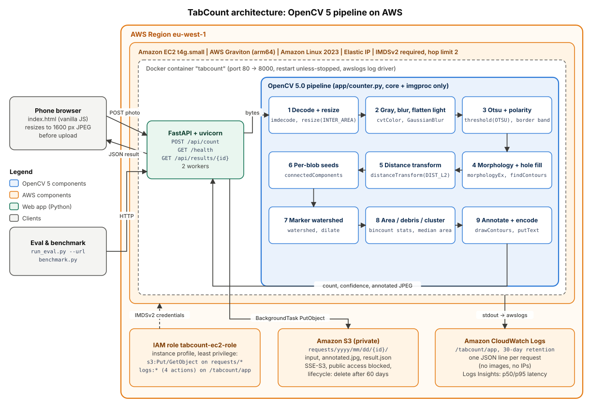
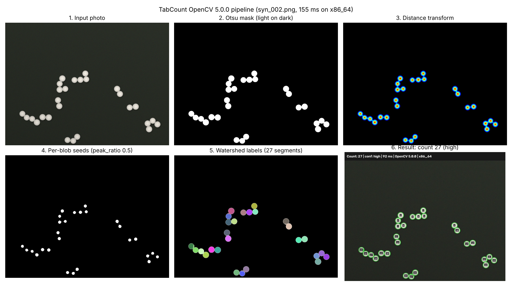

# TabCount: counting tablets from a phone photo with OpenCV 5 on AWS

**OpenCV AI Competition 2026 (powered by AWS) · Technical report · Team TabCount**

Live endpoint: <!--V:LIVE_URL-->{{LIVE_URL}}<!--/V--> · Code: <https://github.com/emediong-etuk/tabcount>

## 1. Problem and real-world impact

Community pharmacies and patent medicine stores in Nigeria often dispense tablets loose, counted out of
bulk containers of 100–1,000. Staff count them by hand, usually in fives with a spatula, at two moments:
when dispensing a prescription and when taking stock. Hand counting is slow during busy hours, and errors
cost money in both directions. Over-dispensing loses stock that is never billed; under-dispensing
short-changes a patient. Stock-takes built on hand counts drift from reality, which hurts re-ordering.

Counting machines exist but are costly; almost every pharmacy assistant already carries a camera phone.
TabCount uses that phone: spread the tablets in one layer, take a photo, get a count with an annotated
image that can be checked at a glance.

## 2. Target users and usage scenario

* **Pharmacists and pharmacy assistants** counting a prescription quantity (for example 30 tablets).
* **Patent medicine vendors** who sell small quantities from bulk packs.
* **Clinic and pharmacy inventory staff** counting partly used containers at stock-take.

Scenario: the assistant tips roughly the right quantity onto a dark tray (or white paper for coloured
tablets) and spreads it into a single layer. They open the TabCount page on their phone, tap **Take photo**,
and within about a second see "**31** · HIGH CONFIDENCE" over an image with every tablet outlined and
numbered. If it says "2 spots may be touching or stacked tablets. Check the orange outlines.", they spread those
tablets and retake. No install or account is needed: it is a mobile web page.

## 3. System architecture



*Figure 1. OpenCV 5 components (blue) run inside a Docker container on an EC2 Graviton instance. AWS
components are orange. Source: `docs/architecture.mmd` (Mermaid) and `scripts/architecture_svg.py`.*

* **Client:** a single static HTML page with vanilla JavaScript and no external resources. It
  downscales the photo on a canvas (longest side ≤ 1600 px, JPEG quality 0.9) before upload. This cuts
  upload time on mobile data and converts iPhone HEIC to JPEG.
* **API:** FastAPI on uvicorn (2 workers). `POST /api/count` validates type (magic bytes: JPEG/PNG/WebP,
  otherwise 415) and size (≤ 10 MB, otherwise 413), runs the pipeline, and returns JSON with the count,
  confidence, warnings, naive baseline count, per-stage timings and the annotated image (base64).
  `GET /health` reports the OpenCV version, CPU architecture and EC2 instance type (read once from IMDSv2).
* **Persistence:** if `TABCOUNT_S3_BUCKET` is set, the input, the annotated image and `result.json` are
  written to S3 as a background task *after* the response is sent. A failed upload is logged and never
  affects the user.
* **Observability:** one structured JSON log line per request (count, baseline, confidence, latency,
  per-stage timings, image size, architecture, OpenCV version). No image data or client IPs are logged,
  and uvicorn's access log is disabled because it records IPs.

## 4. OpenCV 5 implementation

The whole pipeline is in `app/counter.py`. It uses only OpenCV core and imgproc (`imdecode`, `resize`,
`cvtColor`, `GaussianBlur`, `threshold`, `morphologyEx`, `findContours`, `drawContours`,
`distanceTransform`, `connectedComponents`, `dilate`, `watershed`, `putText`, `imencode`) plus NumPy.
None of the modules removed from the OpenCV 5 main build (Haar cascades, HOG, `cv2.ml`, the Caffe loader)
are needed. The module refuses to import unless `cv2.__version__` starts with "5", and every API response
reports the version.



*Figure 2. Pipeline stages on one image: input, Otsu mask, distance transform, per-blob seeds, watershed
labels, annotated result.*

**Decode and resize.** `imdecode` with `IMREAD_COLOR`, which also applies the EXIF orientation from
phone photos. Images are resized with `INTER_AREA` so the longest side is at most 1200 px (never
upscaled). All area parameters are defined at this scale, so behaviour does not depend on the phone's resolution.

**Blur and illumination flattening.** A 5×5 Gaussian blur suppresses sensor noise and tablet texture. Before
thresholding, a smooth lighting gradient is removed: a quadratic surface is fitted to an 80×60 thumbnail
of the grayscale image with iterative outlier trimming (tablets are outliers, the background is the
majority), subtracted, and the image re-centred on the background level. Without it, on images with few tablets and a mild
gradient, Otsu split the *background* itself into two classes (MAE 32.6 → 0.03 on a 40-image synthetic
smoke test after adding it; see `docs/DECISIONS.md`).

**Otsu threshold and polarity detection.** `threshold(..., THRESH_BINARY + THRESH_OTSU)` separates
tablets from background without a hand-tuned threshold. Polarity is automatic: the border band (3% of the
shorter side) should be background, so if more than half of it is foreground the mask is inverted
(`dark_on_light`, e.g. coloured tablets on white paper; otherwise `light_on_dark`).

**Morphology and hole filling.** A 3×3 elliptical close (1 iteration) bridges thin score lines and
imprints, and an open (2 iterations) removes dust. Highlights and embossing can still leave holes inside a
tablet, so external contours are redrawn filled, which makes every blob solid.

**Distance transform and per-blob seeds.** Touching tablets form one blob. `distanceTransform(DIST_L2)`
gives each pixel its distance to the background, so each tablet's centre is a local peak and the neck
between two touching tablets is a valley. The usual tutorial approach thresholds the distance map at a
fraction of the *global* maximum, which breaks when blob sizes vary: one large capsule raises the global
maximum and the small tablets lose their seeds. TabCount normalises **per blob**. Blobs are labelled with
`connectedComponents`, each blob's maximum distance is found in one vectorised pass (`np.maximum.at`),
and a pixel is a seed if `dist ≥ peak_ratio × max_of_its_own_blob` (default `peak_ratio` 0.5). For two
equal discs of radius r touching with up to 15% overlap, the neck's half-width is below 0.5 r, so the seed
regions stay separate. For a single elongated capsule, the ridge above 0.5 r is one connected line, so it
gets one seed.

**Watershed.** Seeds are labelled as markers (background = 1), the uncertain ring
(`dilate(mask) − seeds`) is set to 0, and `cv2.watershed` floods from the markers on the blurred colour
image. Labels ≥ 2 are objects; object pixels are intersected with the mask so the watershed cannot grow
objects into the background.

**Object statistics.** Area, centroid and bounding box for every label come from one pass over
foreground pixels (`np.bincount` for areas and coordinate sums, `np.minimum.at`/`np.maximum.at` for
boxes). Contours for drawing are extracted only inside each object's bounding-box crop, never from
full-image masks per object. This keeps a 12 MP photo well under one second.

**Debris and cluster correction.** Objects smaller than `min_area_px` (60 px) are dropped. With at least
three objects, the median area is the typical tablet: objects below 0.25× the median are crumbs (counted
in `debris_removed`), and objects above 1.8× the median are flagged as possible clusters. These are
tablets the watershed could not split, typically stacked or heavily overlapping. A flagged object counts
as `round(area / median)` tablets. This is a heuristic, so flagged objects are drawn in orange (red for
×3 or more) and lower the confidence.

**Confidence.** `high`: at least three objects, nothing flagged, no warnings. `medium`: flagged objects
are at most 10% of objects. `low`: anything else, including fewer than three objects and any contrast
warning (`no_tablets_found`, `low_contrast_or_background_not_detected`, or `background_region_detected`
when one "object" covers more than 10% of the image).

**Annotation.** Green outlines (orange/red when flagged), numbers in reading order, and a banner above
the photo with count, confidence, time, OpenCV version and CPU architecture. `debug=true` also returns
the mask, distance map, seeds and labels (Figure 2).

**Baseline.** `app/baseline.py` shares `preprocess()` exactly and then counts external contours above
`min_area_px`. The only difference is the watershed and area logic, so the comparison isolates their
contribution. The API returns `baseline_count` with every result.

## 5. AWS deployment

* **Amazon EC2 `t4g.small` (AWS Graviton, arm64)** running Amazon Linux 2023 (AMI from the SSM public
  parameter), in the default VPC, with an **Elastic IP** so the URL is stable through judging. We chose
  Graviton because a small arm64 instance is enough for a CPU-only pipeline and the published OpenCV 5
  wheel ships for `aarch64`. The container builds natively on the instance, so the evaluated code is the
  same arm64 build that serves users.
* **Docker:** `python:3.12-slim` base (official image via the AWS ECR Public mirror), pinned requirements,
  non-root user, `HEALTHCHECK`, `--restart unless-stopped`, port 80 → 8000.
* **IMDSv2 required, hop limit 2.** Hop limit 2 lets boto3 *inside the container* reach the instance-role
  credentials through the Docker bridge. With the default of 1 the request is dropped and S3 uploads fail silently.
* **IAM least privilege:** role `tabcount-ec2-role` (instance profile) may only `s3:PutObject` and
  `s3:GetObject` on `arn:aws:s3:::BUCKET/requests/*`, and create and write streams in the
  `/tabcount/app` log group. No credentials exist in code, config or the image.
* **Amazon S3:** a private bucket with all public access blocked, default SSE-S3 encryption, and a
  lifecycle rule that deletes `requests/` after **60 days** (data minimisation, long enough to cover judging).
* **Amazon CloudWatch Logs:** Docker's `awslogs` driver ships stdout to `/tabcount/app` with 30-day
  retention. A Logs Insights query in the README computes request count and p50/p95 latency per hour.
* **Security group:** TCP 80 from anywhere; SSH only from the administrator's IP.
* **Tooling:** `deploy/provision.py` (boto3, idempotent, confirms the plan first) and `deploy/deploy.py`
  (build on the instance, replace the container, health check, smoke test asserting `aarch64` and OpenCV 5).

## 6. Evaluation

**Datasets.** *Real:* <!--V:REAL_N-->{{REAL_N}}<!--/V--> phone photos taken under
`eval/PHOTO_PROTOCOL.md`: dark and light backgrounds; conditions *separated*, *touching*, *stacked* and
*hard* (glare, white on white, broken halves, mixed types); 5–60 tablets per photo; ground truth counted
twice by hand. The downscaled photos and `labels.csv` are committed, so judges can reproduce every number.
*Synthetic:* 200 generated images (`tools/synthetic.py`, seed 42) with circles and capsule-like ellipses,
radial shading, score lines, noise, blur, lighting gradients and soft shadows. They are separated,
touching (pairs and chains with up to 15% overlap) or mixed. Synthetic results are always reported separately
and are not evidence of real-world accuracy.

**Protocol.** Each dataset is split deterministically: about a third **tune**, the rest **test**.
`peak_ratio` is swept over {0.3, 0.4, 0.5, 0.6, 0.7} on the tune split only. Headline metrics are on
the test split with the **default** parameters, which are the deployed system. A tuned value that
differs from the default is reported separately and is never silently applied. Methods: `watershed` (full
pipeline), `watershed_no_cluster` (cluster correction off; ablation), and `baseline` (naive contours on
identical preprocessing). Metrics: exact-match accuracy, accuracy within ±1, MAE, MAPE, signed bias, by
condition and by background.

**Headline (real photos, test split, n=<!--V:REAL_N_TEST-->{{REAL_N_TEST}}<!--/V-->).** TabCount was exactly
right on <!--V:REAL_EXACT-->{{REAL_EXACT}}<!--/V--> of photos and within ±1 on
<!--V:REAL_WITHIN1-->{{REAL_WITHIN1}}<!--/V--> (MAE <!--V:REAL_MAE-->{{REAL_MAE}}<!--/V-->, bias
<!--V:REAL_BIAS-->{{REAL_BIAS}}<!--/V-->). The naive contour baseline was exactly right on
<!--V:REAL_BASE_EXACT-->{{REAL_BASE_EXACT}}<!--/V--> (MAE <!--V:REAL_BASE_MAE-->{{REAL_BASE_MAE}}<!--/V-->).
Turning cluster correction off gives MAE <!--V:REAL_NOCLUSTER_MAE-->{{REAL_NOCLUSTER_MAE}}<!--/V-->.
Photos marked `high` confidence were exactly right in <!--V:REAL_HIGHCONF_EXACT-->{{REAL_HIGHCONF_EXACT}}<!--/V-->
of cases (n=<!--V:REAL_HIGHCONF_N-->{{REAL_HIGHCONF_N}}<!--/V-->).

**Synthetic (test split, n=<!--V:SYN_N_TEST-->133<!--/V-->; generated images).**
Watershed exact <!--V:SYN_EXACT-->98%<!--/V--> (MAE <!--V:SYN_MAE-->0.04<!--/V-->)
vs baseline exact <!--V:SYN_BASE_EXACT-->29%<!--/V--> (MAE <!--V:SYN_BASE_MAE-->12.21<!--/V-->);
without cluster correction, MAE <!--V:SYN_NOCLUSTER_MAE-->1.20<!--/V-->. The tune-split
sweep picked `peak_ratio` = <!--V:SYN_TUNED_PEAK-->0.6<!--/V--> on synthetic data; on real
photos it picked <!--V:REAL_TUNED_PEAK-->{{REAL_TUNED_PEAK}}<!--/V-->. The code default stays 0.5 unless the
real-photo tune split supports a change. The synthetic set is easy by construction: single tablet type,
clean edges, no stacking.

**Latency.** Server-side pipeline time per image on the evaluation machine
(<!--V:SYN_LAT_ARCH-->x86_64<!--/V-->): p50 <!--V:SYN_LAT_P50-->78.0<!--/V--> ms,
p95 <!--V:SYN_LAT_P95-->99.7<!--/V--> ms (synthetic, 1200×900). A unit test asserts that a
12 MP JPEG is processed in under one second. On the live endpoint
(<!--V:LIVE_INSTANCE-->{{LIVE_INSTANCE}}<!--/V-->, <!--V:LIVE_ARCH-->{{LIVE_ARCH}}<!--/V-->), the benchmark
of <!--V:BENCH_N-->{{BENCH_N}}<!--/V--> requests at concurrency <!--V:BENCH_CONC-->{{BENCH_CONC}}<!--/V-->
measured end-to-end p50 <!--V:BENCH_P50-->{{BENCH_P50}}<!--/V--> ms and p95 <!--V:BENCH_P95-->{{BENCH_P95}}<!--/V--> ms
from the client (including upload), server-side pipeline p50 <!--V:BENCH_SERVER_P50-->{{BENCH_SERVER_P50}}<!--/V--> ms,
and throughput <!--V:BENCH_RPS-->{{BENCH_RPS}}<!--/V--> requests/s with <!--V:BENCH_ERRORS-->{{BENCH_ERRORS}}<!--/V--> errors.

**Deployed consistency check.** `run_eval.py --url` sent every test image to the live AWS endpoint:
<!--V:CONSIST_MATCHES-->{{CONSIST_MATCHES}}<!--/V--> of <!--V:CONSIST_N-->{{CONSIST_N}}<!--/V--> returned
exactly the same count and baseline count as the local evaluation run (match rate
<!--V:CONSIST_RATE-->{{CONSIST_RATE}}<!--/V-->). This shows that the deployed arm64 service is the system that was evaluated.

**Full tables** (generated from `eval/results/*/summary.json`):

<!-- RESULTS:START -->
<!-- generated by scripts/fill_report.py; do not edit by hand -->

**Real phone photos:** {{REAL_RESULTS_PENDING}}

#### Synthetic images (generated, NOT real photos)


Images: 200 labelled (67 tune / 133 test). 

Protocol: peak_ratio swept over [0.3, 0.4, 0.5, 0.6, 0.7] on the tune split only; best by MAE; headline metrics on the test split only. Default params = deployed system.

**Test split (synthetic)**

| Method | n | Exact | Within ±1 | MAE | MAPE % | Bias |
|---|---:|---:|---:|---:|---:|---:|
| watershed | 133 | 98% | 99% | 0.04 | 0.09 | -0.04 |
| watershed no cluster | 133 | 79% | 82% | 1.20 | 3.06 | -1.20 |
| baseline | 133 | 29% | 30% | 12.21 | 34.88 | -12.21 |
| watershed tuned | 133 | 100% | 100% | 0.00 | 0.0 | +0.00 |

**By condition (test)** (method: watershed vs baseline)

| Group | n | Exact (ws) | MAE (ws) | MAE (baseline) |
|---|---:|---:|---:|---:|
| mixed | 44 | 98% | 0.02 | 11.43 |
| separated | 39 | 100% | 0.00 | 0.00 |
| touching | 50 | 96% | 0.10 | 22.42 |

**By background (test)** (method: watershed vs baseline)

| Group | n | Exact (ws) | MAE (ws) | MAE (baseline) |
|---|---:|---:|---:|---:|
| dark | 56 | 100% | 0.00 | 13.16 |
| light | 77 | 96% | 0.08 | 11.52 |

**peak_ratio sweep (tune split, watershed with cluster correction)**

| peak_ratio | MAE | Exact |
|---:|---:|---:|
| 0.3 | 4.76 | 67% |
| 0.4 | 0.70 | 91% |
| 0.5 (default) | 0.01 | 99% |
| 0.6 (best) | 0.00 | 100% |
| 0.7 | 0.00 | 100% |

**Latency** (server-side pipeline, x86_64, OpenCV 5.0.0): p50 78.0 ms, p95 99.7 ms.

**Confidence vs accuracy (test, watershed)**

| Confidence | n | Exact | MAE |
|---|---:|---:|---:|
| high | 105 | 100% | 0.00 |
| medium | 14 | 100% | 0.00 |
| low | 14 | 79% | 0.43 |


**Live endpoint benchmark:** {{BENCHMARK_PENDING}}

<!-- RESULTS:END -->


**Failure gallery.** `eval/results/real/failures/` holds the annotated worst test images and a captioned
contact sheet (`docs/figures/real_failures_contact_sheet.jpg`).


Failure types and their causes:

* **Stacked tablets** (expected). A tablet lying partly on another shows as one blob with an unusual
  shape. Cluster correction recovers some of these through area, but a tablet hidden under another adds
  no visible area, so stacking causes *under-counting*. The orange outline and lower confidence are the mitigation.
* **Glare and specular highlights.** Flash or a lamp creates bright patches that join the foreground on dark
  backgrounds, or punch holes that break a tablet in two on light backgrounds. Hole filling fixes small
  holes; large highlights can split a tablet (over-count) or merge neighbours.
* **Low contrast (white on white).** When tablet and background grey levels overlap, Otsu has no valley
  to find. The pipeline then reports `low_contrast_or_background_not_detected` or `no_tablets_found`
  and `low` confidence instead of a confident wrong number.
* **Broken tablets.** Halves are about 50% of the median area: above the 25% debris cut, so each counts as
  one. Whether that is right depends on the pharmacy's policy.
* **Mixed tablet types.** With two sizes the median is meaningless, so large tablets are flagged and over-counted.

## 7. Limitations

* **Single layer only.** Stacked tablets cannot be counted reliably from a single top-down view.
* **One tablet type per photo.** The debris and cluster logic assume one typical size.
* **Contrasting, plain background required.** Patterned cloth, wood grain and white-on-white break Otsu.
* **Glare and very uneven lighting.** Flattening handles smooth gradients, not hard shadows or specular highlights.
* **Cluster correction is a heuristic.** `round(area / median)` is only an estimate. It is flagged, never silent.
* **Broken tablets** are counted as whole tablets or ignored as debris, depending on size.
* **No drug identification.** TabCount counts objects; it does not know what they are.
* **Real evaluation set is small** (about 30 photos from one phone and one person); results may not
  generalise to every phone, tray or lighting.

## 8. Responsible use

* **A counting aid, not a replacement for pharmacist verification.** The confidence badge, orange
  cluster outlines and plain-language warnings exist to prompt a re-check. The footer says "Always verify
  counts before dispensing."
* **No drug identification and no dosing advice.** The system never names a drug or suggests a dose.
* **No personal data.** No accounts, no names, no prescriptions; client IPs are not logged. Users should
  photograph only tablets on a tray, not labels or prescriptions.
* **Private storage with automatic deletion.** S3 objects are private, encrypted at rest, and deleted after 60 days.
* **Over-trust risk.** Correct counts on easy photos can lead users to stop checking hard ones.
  Mitigations: any warning forces `low` confidence, numbered outlines make checking fast, and we claim
  no accuracy beyond the measured results.

## 9. Future work

* **Guided capture:** live camera overlay checking contrast, glare and single-layer spread before the shot.
* **On-device processing:** run the same OpenCV pipeline in the browser (OpenCV.js) for offline use.
* **Stock-system integration:** send counts to pharmacy inventory software with the annotated image as an audit record.
* **Multi-type counting:** cluster objects by colour and shape to count two tablet types in one photo.

## 10. Reproducibility

```
python -m venv .venv && (activate) && pip install -r requirements-dev.txt
python -m pytest                                              # unit + API tests, no AWS needed
python scripts/make_synthetic.py --n 200 --seed 42 --out eval/data/synthetic
python scripts/run_eval.py --data eval/data/synthetic
python scripts/run_eval.py --data eval/data/real              # committed photos + labels.csv
python scripts/run_eval.py --data eval/data/real --url http://ELASTIC_IP
python scripts/benchmark.py --url http://ELASTIC_IP --images eval/data/real --n 100 --concurrency 4
python scripts/fill_report.py
```

Pinned versions: `opencv-python-headless==5.0.0.93` (the only OpenCV package), `numpy==2.5.4`,
`fastapi==0.162.0`, `uvicorn==0.54.0`, `python-multipart==0.0.32`, `boto3==1.43.118`, Python 3.12.
The full freeze is in `requirements.lock.txt`. Deviations from the original plan are in `docs/DECISIONS.md`.

## 11. Team

**TabCount** is a solo entry by **Emediong Etuk Gregory ("Greg")**, a backend engineer (PHP/Laravel,
Next.js/TypeScript) with a B.Eng. in Computer Engineering from the University of Uyo, Nigeria.
Development was assisted by Claude Code.
