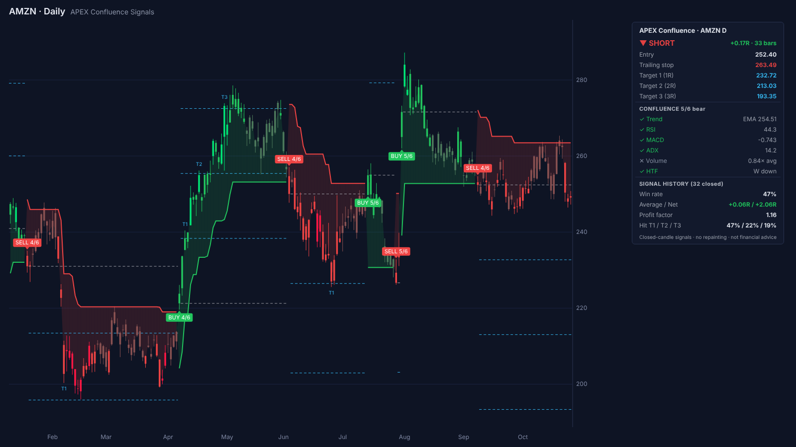
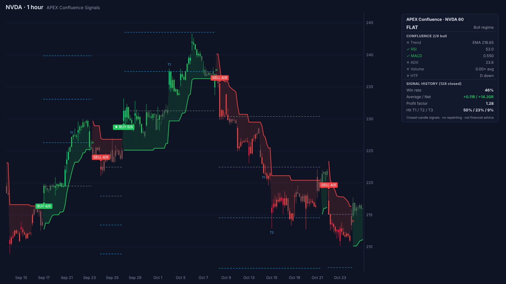
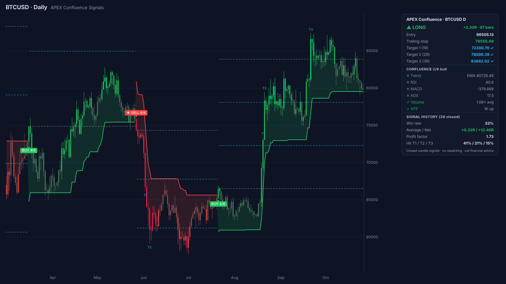

# APEX Confluence Signals: a TrendSpider buy/sell indicator

**Category:** Buy/Sell Signal Indicator (on-chart)
**File to paste into TrendSpider:** [`apex_confluence_signals.js`](apex_confluence_signals.js)



APEX gives clear BUY and SELL signals that don't repaint. An ATR trailing stop decides the trend. A signal only fires when the trend flips **and** at least 4 of 6 independent checks agree. Every signal comes with an entry, a stop and three targets. A dashboard on the chart scores every past signal on that symbol and time frame, so you can see how the settings perform before you rely on them.

## What you see on the chart

| Element | Meaning |
|---|---|
| **BUY 5/6** (green, below candle) | Long signal. `5/6` is how many checks agreed. `★` means all 6 agreed. |
| **SELL 4/6** (red, above candle) | Short signal (or the exit point for longs, if you trade long only). |
| Green / red stop line | ATR trailing stop. Green = bull regime, red = bear regime. It is the live stop for the open trade. |
| Shaded cloud | Distance from price to the trailing stop, colored by regime. |
| Dashed grey / blue ladders | Entry price and Targets 1-3 of the open trade. They disappear when the trade closes. |
| `T1` `T2` `T3` | The candle where a target was first reached. |
| `✕` / `BE` | Trade closed: trailing stop flipped (`✕`) or breakeven stop hit (`BE`). |
| Candle colors | Regime color, brightness = confluence. Bright = all 6 checks, normal = enough checks, muted = trend without confirmation. |
| Dashboard | Current position, open R, stop and targets, a live check-by-check confluence list, and the signal history (win rate, average/net R, profit factor, target hit rates). |

## How a signal is made

1. **Regime.** A SuperTrend-style ATR trailing stop (ATR 14 × 3 by default) flips between bull and bear. Flips use candle closes only.
2. **Confluence.** On each candle, 6 checks are scored for the regime's side:

   | Check | Bull side passes when… (bear side is the mirror) |
   |---|---|
   | Trend | close > EMA(50) and the EMA is rising |
   | RSI | RSI(14) > 50 |
   | MACD | MACD(12, 26) line > its 9-period signal line |
   | ADX | ADX(14) is rising over 3 candles and +DI > −DI |
   | Volume | volume > 1.0 × its 20-candle average. Counts as a pass on symbols with no volume data. |
   | HTF | the previous **closed** higher-time-frame candle closed above its EMA(20). Auto picks 1h → D → W → M. |

3. **Signal.** The first candle of a new regime with at least *Min confirmations* passing gets the signal. If the flip candle doesn't qualify, the signal can still come up to *Late-entry window* candles later. There is never more than one signal per regime, so the chart stays clean.
4. **Trade.** Entry = signal close. Risk (1R) = distance to the trailing stop. Targets sit at 1R / 2R / 3R. The trade is closed when the trailing stop flips. Optionally you can move the stop to breakeven after T1, or scale out a third at T1 and T2.

**Why the ADX check is "rising", not "above 20".** Right after a flip, a high ADX still measures the trend that just ended. In testing, flips with ADX > 20 did *worse* than flips out of quiet markets. "ADX rising with the matching DI leading" asks whether the *new* move is gaining strength.

## No repainting

- Everything is computed from closed candles. The higher-time-frame trend uses the previous **closed** HTF candle, so there is no lookahead.
- Signals on the last, still-forming candle can change until that candle closes, like any closed-candle indicator. Set alerts to fire **on candle close**.
- The test suite checks this directly. It re-runs the script on every shorter history and confirms that no past signal, stop, label or candle color ever changes (see [Testing](#testing)).

## Inputs

| Tab | Input | Default | Notes |
|---|---|---|---|
| Signals | ATR length / multiplier | 14 / 3 | Trailing stop. Higher multiplier = fewer, longer trades. |
| | Min confirmations (of 6) | 4 | 0 = every flip signals. 6 = only perfect setups. |
| | Late-entry window (candles) | 8 | How long after a flip a signal may still fire. |
| | Trade direction | Long & Short | `Long only` hides SELL entries (longs still exit on the flip). |
| Filters | Trend EMA, RSI, MACD, ADX lengths | 50, 14, 12/26/9, 14 | |
| | Volume average length / factor | 20 / 1.0 | |
| | Higher time frame / HTF EMA length | Auto / 20 | `Off` disables the check. A time frame that isn't higher than the chart is ignored. |
| Targets | Target 1/2/3 (R) | 1 / 2 / 3 | |
| | Trade management | Trail only | `Breakeven after T1`, `Scale out at targets` |
| Display | Color candles, entry/targets, trend cloud, dashboard, dashboard position | on | |

Line colors and thickness can be changed in TrendSpider's own properties dialog. The `Trend EMA` line is hidden by default.

## Scanners, alerts and the Strategy Tester

The indicator registers these signals for the Visual Script editor: **Buy, Sell, Strong Buy, Strong Sell, Long Exit, Short Exit, Bull Regime, Bear Regime**. It also exposes hidden **Bull Score** and **Bear Score** series (0-6).

Examples:
- Scanner: `APEX Buy Signal emerged` on Daily for today's fresh long setups.
- Scanner: `APEX Bull Score >= 5` and `APEX Bull Regime Signal active` for stocks in a confirmed uptrend.
- Strategy Tester: Entry `APEX Buy Signal emerged`, Exit `APEX Long Exit Signal emerged`.
- Alert: `APEX Strong Buy Signal emerged`, set to trigger on candle close.

## Install

1. In TrendSpider, open the custom JavaScript indicator editor and create a new indicator.
2. Replace the template with the full contents of [`apex_confluence_signals.js`](apex_confluence_signals.js) and click **Save**.
3. Add *APEX Confluence Signals* to any candle chart. It works on stocks, ETFs, crypto, futures and FX, on intraday to monthly charts.

## Testing

The script runs under Node with a small mock of the TrendSpider scripting API ([`test/mock_trendspider.js`](test/mock_trendspider.js)), built from the official docs.

```bash
node test/run_tests.js                  # synthetic data
node test/run_tests.js path/to/data     # also real OHLCV files (TICKER_D.json, TICKER_60.json)
```

The tests check that:
- the script paints and registers the same named outputs under every input combination, on short charts, without volume, and when `request.history` fails or returns an error. TrendSpider requires this, see *Common mistakes* in the docs.
- signals follow the rules: at most one per regime, buys only in bull regimes, labels match signals.
- **nothing repaints:** every signal, stop line, label and candle color stays the same when the script is re-run on any shorter history. This also catches higher-time-frame lookahead.
- the dashboard's net R matches an independent recount of the trades from the raw signals.

`node test/render_preview.js <data.json> <TICKER> <resolution> <out.png>` renders the preview images in [`docs/`](docs/).

### Results on real data (default settings, both sides, trailing exit)

Yahoo Finance data, about 5 years of daily candles and about 2 years of hourly candles, as of Oct 2026:

| Data | Trades | Win rate | Avg R / trade | Net R |
|---|---|---|---|---|
| Daily: AAPL, AMZN, BTC, S&P 500, META, NVDA, SPY, TSLA, XOM | 292 | 39% | +0.15R | +44.3R (profitable on all 9) |
| Hourly: AAPL, AMZN, META, NVDA, SPY, TSLA, XOM | 935 | 39% | +0.04R | +37.9R (4 of 7 profitable) |
| Daily, long only | 151 | 45% | +0.42R | +64.0R |
| Hourly, long only | 480 | 43% | +0.24R | +114.0R |

How to read these numbers:
- This is a trend-following system. Win rates around 40% are normal: a few large winners pay for many small losses.
- On hourly charts the confluence filter matters. With every flip taken (min confirmations 0), hourly net R was −7.6R. With 4 of 6 it was +37.9R. Across all 16 datasets, 4 of 6 beat no filter in both the first and the second half of the data.
- Shorts on stocks lost money over this period, which was mostly a bull market. That's why long only does better. The dashboard shows this per symbol, so check it before trading shorts.
- Results are R-multiples before costs and slippage. Past results don't guarantee future results. Not financial advice.

## Files

```
apex_confluence_signals.js   the indicator (paste this into TrendSpider)
test/mock_trendspider.js     mock TrendSpider runtime for Node
test/run_tests.js            tests: output stability, signal rules, no repainting, stats recount
test/render_preview.js       renders the preview images
docs/                        preview images (AMZN daily, NVDA 1h, BTC daily)
```

## Store listing text (draft)

> **APEX Confluence Signals: clean buy/sell signals that don't repaint, with a built-in scorecard.**
>
> APEX waits for the trend to turn (ATR trailing stop) and only signals when at least 4 of 6 independent checks agree: trend EMA, RSI, MACD, ADX strength, volume and the higher-time-frame trend. One signal per trend, with entry, stop and three R-based targets drawn on the chart. Candles are colored by trend and confluence. A live dashboard shows the open trade, which checks pass right now, and how every past signal on this chart performed (win rate, average R, profit factor, target hit rates).
>
> Includes Buy / Sell / Strong / Exit / Regime signals for scanners, alerts and the Strategy Tester, plus breakeven and scale-out trade management. Works on any symbol and time frame.

| AMZN daily | NVDA 1 hour | BTC daily |
|---|---|---|
|  |  |  |
